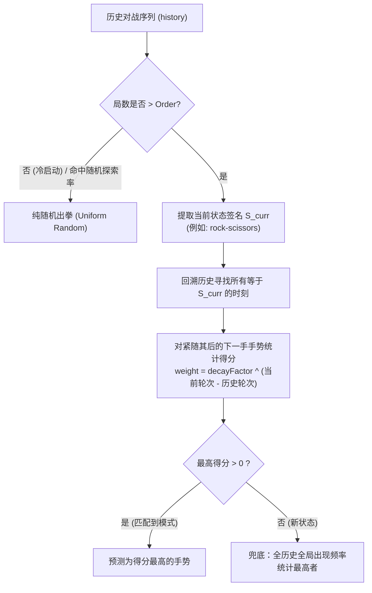
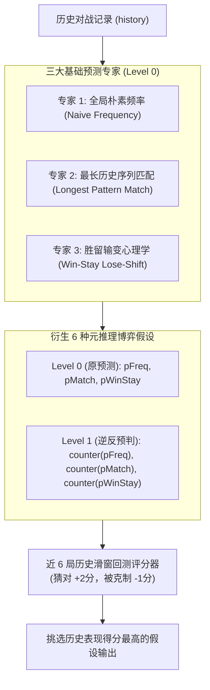

# 🎮 rpsluna 系统架构设计与调研规划方案 (v1.0)

> **文档标识**：`20261106-173000.init.md`  
> **项目代号**：`rpsluna` (石头剪刀布多模态博弈平台 / 整合包)  
> **项目定位**：基于 Koishi 微内核架构、多模态手势识别、多阶博弈论与 LLM 心理战的石头剪刀布交互生态平台。

---

## 一、 系统全局拓扑图

```
                           ┌────────────────────────────────────────────────────────┐
                           │                 公网玩家 / 评委 / 微信扫码              │
                           └───────────────────────────┬────────────────────────────┘
                                                       │ (FRP 穿透安全端口，如 18080)
                                                       ▼
                                       ┌────────────────────────────────┐
                                       │    @rpsluna/renderer-portal    │
                                       │ (独立 Express/Fastify 玩家对战端)│
                                       └───────────────┬────────────────┘
                                                       │ 内部 RPC / EventEmitter
                                                       ▼
 ┌───────────────────────────┐      ┌─────────────────────────────────────┐      ┌───────────────────────────┐
 │     聊天平台 (Bot 用户)    │      │                                     │      │    Koishi Console 大屏    │
 │  (QQ/OneBot/Discord/CLI)  ├─────►│          @rpsluna/core              │◄─────┤ (管理员/开发者全功能控制台) │
 └───────────────────────────┘      │     (多房间多并发会话仲裁核心)      │      └───────────────────────────┘
                                    │                                     │
 ┌───────────────────────────┐      │  • Session/Room 管理器              │      ┌───────────────────────────┐
 │   adapter-window (窗口捕获)│─────►│  • 统一出拳规范 (Rock/Paper/Scissors)│◄─────┤   adapter-buttons (纯按键) │
 │  - 模式1: Node 内置截屏   │      │  • 倒计时制 / 连续流式状态机        │      │ (脱机测试 / 兜底调试)      │
 │  - 模式2: Python UV 伴侣  │      │  • 胜率/心理对战历史追踪            │      └───────────────────────────┘
 └───────────────────────────┘      └──────────────────┬──────────────────┘
                                                       │
                                     ┌─────────────────┴─────────────────┐
                                     │         可插拔策略引擎集群         │
                                     ├───────────────────────────────────┤
                                     │ • strategy-random (纯真随机基准)   │
                                     │ • strategy-markov (N阶马尔可夫转移)│
                                     │ • strategy-iocaine (历史经典博弈)  │
                                     │ • strategy-llm (NewAPI 心理战/读心)│
                                     │ • strategy-cheat (瞬时视觉作弊预判)│
                                     └───────────────────────────────────┘
```

---

## 二、 核心模块与职责定义

### 1. 核心调度层：`@rpsluna/core`
- **服务声明**：作为 Koishi 原生服务注入，在上下文提供 `ctx.rpsluna`。
- **并发多房间管理（Room/Session Manager）**：
  - 一个 Koishi 实例天然承载多个并发对战会话，房间之间完全隔离：
    - **Room A**：本地开发者本人使用（RustDesk 投屏窗口 + 马尔可夫博弈策略）；
    - **Room B**：外部评委/朋友通过 FRP 穿透公网 Web 访问（纯按钮/Web手势 + LLM 读心术）；
    - **Room C**：聊天群群友通过群指令触发（文字对战）。
- **双对战节奏引擎**：
  - **模式 A（回合倒计时制）**：准备 -> 界面倒数“3、2、1” -> 倒数归零瞬间冻结并判定手势帧 -> 双方出拳结算与播报（适合演示与正式对决）。
  - **模式 B（连续流式对决）**：手势持续识别，消除抖动（稳定 0.5s）后自动触发判定 -> 实时累加连击比分（适合快速喂给马尔可夫与 LLM 博弈数据）。

### 2. 四大输入与交互途径（本期规划）
| 途径 | 对应插件/模块 | 场景与架构特点 |
| :--- | :--- | :--- |
| **途径 1：窗口捕获 (核心)** | `@rpsluna/adapter-window` | **双轨制运行**：<br>① **Node 内置模式**：纯 Node.js 实现屏幕/窗口截取，零额外依赖；<br>② **Python UV 伴侣模式**：通过 HTTP/WS 接收 `tools/window_detector/` 伴侣脚本（OpenCV + MediaPipe）的高帧率精准手势流。 |
| **途径 2：独立公网 Portal** | `@rpsluna/renderer-portal` | 独立开辟服务端口（如 `18080`），运行轻量 WebUI，通过 FRP 穿透给公网免登录畅玩，与 Koishi 管理面板物理隔离，保障后台安全。 |
| **途径 3：Koishi WebUI 大屏** | `@rpsluna/renderer-console` | 作为 `@koishijs/plugin-console` 的侧边栏自定义页面，提供管理员级对战大屏：实时视频骨骼点预览、各房间状态与算法胜率折线图。 |
| **途径 4：指令与纯按键** | `@rpsluna/adapter-command` + `adapter-buttons` | 支持聊天平台指令（`/rps 石头`）以及 WebUI 下方备用的 1/2/3 纯按键（用于断网、无光照或快速调试的保底手段）。 |

### 3. 可插拔博弈策略集群（Strategy Registry）
统一实现策略接口：`predict(history: RoundResult[]): Promise<'rock' | 'paper' | 'scissors'>`。
1. **`strategy-random`**：真随机基准线（严格 1/3 均匀分布）。
2. **`strategy-markov`**：基于转移概率矩阵建模人类“赢留输变（Win-Stay Lose-Shift）”与惯性循环心理。
3. **`strategy-iocaine`**：经典 Iocaine Powder 算法，维护多阶“我猜你猜我猜你会出什么”的元推理（Meta-Reasoning）动态权衡。
4. **`strategy-llm`**：接入 NewAPI，为大模型注入前序多局对战轨迹与玩家出手节奏，输出心理弱点分析台词与克制出拳。
5. **`strategy-cheat`**：作弊彩蛋模式，利用毫秒级视觉时间差抢先克制出拳并嘲讽。

---

## 三、 本地调试与插件加载方案（宿主与 Monorepo 的集成方式）

在开发期，`rpsluna` 作为独立的插件 Monorepo（`D:\TMP\ywl-rps\rpsluna`），与 Koishi 宿主工程（`D:\TMP\ywl-rps\koishi-ywl-rps`）有以下两种成熟的加载方案：

### 方案 A：Workspaces 相对路径引入（无侵入、配置即用）
在 `koishi-ywl-rps/package.json` 的 `workspaces` 配置项中，直接声明包含上级目录中的插件工作区：
```json
{
  "workspaces": [
    "external/*",
    "../rpsluna/packages/*"
  ]
}
```
> [!NOTE] 目录同级要求
> 此方案生效的前提是 **`koishi-ywl-rps` 与 `rpsluna` 必须处于同级目录**（如当前都在同一父目录下，即 `../rpsluna`）。若在你的环境下两者的相对目录层级不同，请相应调整该相对路径或直接填写绝对路径。

- **优点**：无需操作文件系统链接，跨平台移植性好，只要相对路径不变，直接执行 `yarn` 即可完成本地符号链接。

### 方案 B：目录联接 / 软链接（Windows Directory Junction）
在 `koishi-ywl-rps` 的 `external/` 目录下建立指向 `rpsluna` 的目录联接：
```powershell
New-Item -ItemType Junction -Path "D:\TMP\ywl-rps\koishi-ywl-rps\external\rpsluna" -Target "D:\TMP\ywl-rps\rpsluna"
```
- **优点**：`koishi-ywl-rps` 原生默认包含 `external/*` 与 `external/*/packages/*`，完全不需要改动宿主的 `package.json`，随时可以插拔删除。

> **HMR 热重载机制**：无论是方案 A 还是方案 B，只要在 `koishi-ywl-rps` 下执行 `yarn dev`，Koishi 的 `esbuild-register` 与 `@koishijs/plugin-hmr` 均能直接监听 `.ts` 源码变动，保存文件即可毫秒级热加载！

---

## 四、 Monorepo 目录结构规范

```
D:\TMP\ywl-rps/
├── koishi-ywl-rps/                  # Koishi 宿主整合包环境
│   ├── external/                    # 外部插件挂载点 (方案 B)
│   ├── koishi.yml                   # 运行时插件配置
│   └── package.json                 # 宿主依赖与 workspaces
│
├── rpsluna/                         # 独立插件生态 Monorepo (核心代码区)
│   ├── packages/
│   │   ├── core/                    # @rpsluna/core (核心服务、房间管理器、状态机)
│   │   ├── adapter-window/          # @rpsluna/adapter-window (窗口捕获：Node内置 + 网络接收)
│   │   ├── adapter-buttons/         # @rpsluna/adapter-buttons (UI/键盘纯按键兜底驱动)
│   │   ├── strategy-markov/         # @rpsluna/strategy-markov (马尔可夫博弈策略)
│   │   ├── strategy-llm/            # @rpsluna/strategy-llm (NewAPI 心理战大模型策略)
│   │   ├── strategy-all/            # 常用策略聚合包 (random / iocaine / cheat)
│   │   ├── renderer-portal/         # 独立端口 Web 游戏对战端 (Express + 页面)
│   │   └── renderer-console/        # Koishi Console 管理大屏扩展插件
│   │
│   ├── tools/                       # 伴侣工具箱
│   │   └── window_detector/         # Python UV 高帧率窗口捕获伴侣
│   │       ├── pyproject.toml       # 声明 mss, opencv-python, mediapipe, websockets
│   │       ├── detector.py          # 窗口抓取与手势识别推流脚本
│   │       └── README.md            # "uv run detector.py" 一键启动指南
│   │
│   ├── plan/                        # 项目调研与规划文档
│   │   └── 20261106-173000.init.md  # 本初始化设计文档
│   │
│   ├── package.json                 # Yarn Workspaces 根声明
│   ├── tsconfig.base.json           # 统一 TypeScript 基础配置
│   ├── yakumo.yml                   # Yakumo 构建配置
│   └── README.md                    # 模块导览与快速上手文档
```

---

## 五、 实施路线图（三阶段）

1. **第一阶段：骨架初始化与核心调度器（Foundation）**
   - 建立 `rpsluna` 根工作区，初始化 `@rpsluna/core` 的服务与类型定义；
   - 实现房间管理器（Room Manager）与双对战状态机（倒计时 vs 流式）；
   - 实现 `adapter-buttons` 与 `strategy-random` / `strategy-markov`，在 Koishi 控制台中完成端到端闭环验证。
2. **第二阶段：双轨制窗口捕获（Window Adapter & Python UV）**
   - 实现 `@rpsluna/adapter-window` 的 Node 端 HTTP/WS 接收网关；
   - 在 `tools/window_detector/` 编写 Python 脚本，验证针对 RustDesk 投屏窗口的实时手势检测与数据推送；
   - 补充 Node 内置截屏实现，实现脱离 Python 的应急容灾。
3. **第三阶段：多端呈现与 LLM 心理战（Portal, Console & LLM）**
   - 实现 `@rpsluna/renderer-portal` 独立端口 Web 页面（适配 FRP 公网免登录访问）；
   - 接入 NewAPI（`strategy-llm`）输出毒舌裁判台词与心理学诊断报告；
   - 实现 `@rpsluna/renderer-console`，在 Koishi 后台呈现数据看板。

---

## 六、 核心博弈策略算法原理与业务决策逻辑详解 (Strategy Deep Dive)

平台的核心策略层采用**统一预测接口规范**：
```typescript
predict(history: RoundRecord[], meta?: any): Promise<'rock' | 'paper' | 'scissors'>
```
> **统一职责约定**：策略层只负责**预测玩家下一手最可能出什么（Prediction）**；核心仲裁层（`core`）根据预测结果统一决定是“出克制手势（必胜）”、“放水输掉（激励）”还是“平局”，保证了认知模型与商业游戏规则的完全解耦。

---

### 1. N 阶马尔可夫转移模型 (`rpsluna-strategy-markov`)

- **定位**：轻量级自适应概率预测器，特别擅长捕捉人类玩家的**习惯性出拳路径**与**惯性循环**。
- **核心算法**：$N$-gram 状态序列匹配 + 指数时间衰减加权（Time Decay）。



#### 详细工作流程与业务逻辑：
1. **冷启动与防死锁**：若历史对局数不超过阶数 $N$（默认 $N=2$），或随机数命中探索率（默认 5%），直接返回真随机，打破预测死锁。
2. **状态签名提取**：将玩家最近 $N$ 局出拳拼接为状态字符串（例如：玩家连续出了石头和剪刀，签名即为 `"rock-scissors"`）。
3. **时间衰减加权扫描**：遍历历史记录，找出历史上所有出现过该状态签名的局数，取出紧随其后的手势，并根据距离当前的时间跨度施加指数衰减权重：
   $$\text{Weight} = \text{decayFactor}^{\Delta t} \quad (\text{默认 } decayFactor=0.85)$$
   **业务含义**：人类玩家前 3 分钟的习惯和刚才 3 局的习惯可能发生漂移，越近的对局权重越高。
4. **决策判定与优雅降级**：
   - 比较石头、剪刀、布的加权总分，输出得分最高者；
   - 若该状态历史上从未出现过，则优雅降级为**全历史全局出拳频率最高项**。

---

### 2. Iocaine Powder 传奇博弈大师 (`rpsluna-strategy-all` / `iocaine`)

- **定位**：源自 1999 年国际石头剪刀布编程大赛冠军 Dan Egnor 算法，专为应对**懂心理学的高水平玩家**设计。
- **核心算法**：**多专家系统（Multi-Expert）+ 元推理博弈仲裁（Meta-Reasoning）**。



#### 详细工作流程与业务逻辑：
1. **三大基础专家预测器**：
   - **频率分析（Naive Frequency）**：统计玩家从第一局至今出得最多的手势；
   - **最长模式匹配（Pattern Matching）**：从最近 5 局的历史模式由长到短依次向前滑动匹配，找到历史上最长一致序列后的下一次出拳；
   - **胜留输变（Win-Stay Lose-Shift）**：人类博弈心理学特征：
     - 若上一局玩家**赢了**：倾向于**保持**相同手势；
     - 若上一局玩家**输了**：倾向于**变动**，且大概率换成**能克制 AI 上一局出拳的手势**。
2. **元推理假设池（Meta-Reasoning）**：
   - 玩家可能是小白（直接按专家预测出拳，即 $L_0$ 假设）；
   - 玩家可能是高手（心想“AI 肯定以为我要出这个，我偏要出克制它的手势”，即 $L_1$ 逆反假设）；
   - 平台将 3 个专家的 $L_0$ 和 $L_1$ 组合为 **6 个候选假设**。
3. **动态回测评分仲裁**：
   - 截取最近 6 局对战历史作为模拟考场，分别用这 6 个假设去拟合历史；
   - 命中真实出拳加 2 分，被反克制扣 1 分；最终动态选出**当前局势下适应度最高、得分最高的假设**作为最终预测。

---

### 3. LLM 心理战读心大师 (`rpsluna-strategy-llm`)

- **定位**：接入通用大模型（NewAPI / OpenAI 兼容端点），具备**自然语言个性化台词**与**高级心理认知推断**的双重价值。
- **核心算法**：情境学习（In-Context Learning）+ 结构化 JSON 提示工程 + 拟人人设驱动。

#### 详细工作流程与业务逻辑：
1. **历史对战轨迹序列化**：
   - 提取最近 8 局对决的完整轨迹，包含轮次、玩家出拳、AI 出拳、对决胜负胜败；
   - 组装系统 Prompt，设定对手人设性格（`toxic` 毒舌傲娇、`professor` 心理学教授、`chuuni` 中二宿命家）。
2. **结构化输出约束**：
   - 强制启用 `response_format: { type: 'json_object' }`；
   - 约束返回协议：
     ```json
     {
       "prediction": "rock" | "paper" | "scissors",
       "commentary": "简短的一句话心理嘲讽或点评(15字内)"
     }
     ```
3. **大屏交互增益**：
   - 模型输出的 `commentary` 台词会直接注入到当前局的元数据中，供大屏（8498 对决屏 / Portal）的角色对话气泡实时展示，互动戏剧感极强。
4. **工业级降级与容灾**：
   - 若未配置 API Key 或历史局数少于 2 局，展示“数据收集观察中...”并自动降级为随机；
   - 配置毫秒级超时控制（默认 3000ms），一旦网络拥塞或 API 异常，立即平滑降级为前序对局推导，绝不阻塞大屏游戏进程。

---

### 4. 瞬时读心作弊彩蛋 (`rpsluna-strategy-all` / `cheat`)

- **定位**：技术展示、压力测试与特定娱乐彩蛋模式。
- **核心算法**：利用**视觉识别完成到大屏动画定格之间的毫秒级时间差**进行逆向劫持。
- **业务逻辑**：直接在判定帧前偷窥事件总线上传入的 `currentEvent.choice`，返回与玩家当前手势完全一致的预测，核心引擎克制出拳，达成 **100% 绝对必胜**与降维打击效果。

---

### 5. 策略特性横向对比与商显/大屏场景推荐

| 策略名称 | 冷启动门槛 | 算力消耗 | 对小白胜率 | 对高玩胜率 | 核心亮点 | 推荐应用场景 |
| :--- | :---: | :---: | :---: | :---: | :--- | :--- |
| **`random`** | 0 局 | 极低 ($\approx 0$) | 33% | 33% | 绝对公平基准线 | 教学模式、抽奖判定 |
| **`markov`** | $\ge 3$ 局 | 极低 ($<1\text{ms}$) | 60% ~ 75% | 45% ~ 55% | 快速学习、短期惯性克星 | **商场/幼儿园大屏首选**（即开即玩） |
| **`iocaine`** | $\ge 4$ 局 | 低 ($<2\text{ms}$) | 65% ~ 80% | 65% ~ 75% | 胜留输变心理学 + 元推理仲裁 | 挑战硬核评委、连续多局挑战赛 |
| **`llm`** | $\ge 2$ 局 | 依赖外网/网络 | 50% ~ 70% | 60% ~ 70% | 毒舌嘲讽与心理报告生成 | 展厅吸睛互动、扫码朋友圈分享 |
| **`cheat`** | 0 局 | 极低 | 100% | 100% | 绝对读心外挂彩蛋 | 开发者调优、特定娱乐惩罚模式 |

> 💡 **针对大屏与实体落地（商场/幼儿园）的策略编排建议**：
> - **第 1 ~ 3 局**：采用 `markov` 快速捕捉小朋友的下意识习惯，若需要激发兴趣，可通过 `core` 配合放水机制让小朋友先赢 1 局；
> - **第 4 局以后**：切换至 `markov` 或 `iocaine` 开启“读心模式”，屏幕上显示“露娜已看穿你的出拳规律！”，胜率提升带来强烈的科技感震撼！
