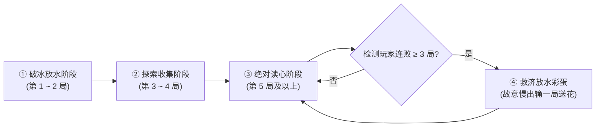
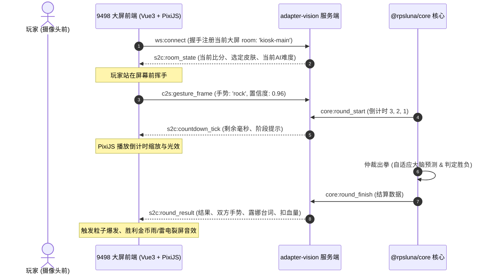

# 🎯 rpsluna 多模态商显体感大屏与三大场景演进方案 (v2.0)

> **文档标识**：`20261118-165700.vision-kiosk.md`  
> **制定时间**：2026-11-18 16:57:00  
> **项目代号**：`rpsluna` (多模态石头剪刀布交互生态平台)  
> **本期目标**：厘清 8498 / 9498 / Koishi 控制台三端职责边界；确定 Vue 3 + PixiJS 大屏动效双层渲染架构；落地四阶段「智能自适应读心」算法编排；并列推进三大场景交互皮肤（低幼童趣 / 商场中庭 / 高校赛博）。

---

## 一、 系统三端物理边界与端口职责定调

为了避免概念与端口混淆，平台将“玩家交互”、“体感大屏”与“运维管控”彻底解耦为三个独立的展现形态：

```
┌────────────────────────────────────────────────────────────────────────┐
│                        外部商显大屏 (65寸+ 触控/显示器)                  │
│                     http://localhost:9498 (Vision 互动大屏舞台)         │
│   • 纯净全屏 Kiosk 游戏大屏（无后台杂项，全屏沉浸）                     │
│   • Vue 3 外层 HUD + PixiJS WebGL 高刷游戏视口                         │
│   • 实时摄像头画中画 (HUD 镜子) + 骨骼手势拖尾光效                       │
└───────────────────────────────────▲────────────────────────────────────┘
                                    │ WebSocket 高频游戏状态 & 视觉手势
                                    ▼
┌────────────────────────────────────────────────────────────────────────┐
│                         Koishi 宿主后端核心                             │
│                  (@rpsluna/core + adapter-vision)                      │
│                                   │                                    │
│   ┌───────────────────────────────┴────────────────────────────────┐   │
│   ▼                                                                ▼   │
│ 【基础按键/备用 Portal】                                    【全域运维管控中心】  │
│  http://localhost:8498                                      Koishi 控制台原生内嵌│
│  (纯按钮/兜底调试端)                                        (参考 bili-live-music)
│  - 纯按键点击 / 键盘 1/2/3                                  - 实时对局状态机大盘 
│  - 无摄像头/弱光/断网兜底                                   - 视觉伴侣/摄像头标定
│                                                             - 胜率统计与策略热切换
└────────────────────────────────────────────────────────────────────────┘
```

### 三端职责明细表：
| 端形态 | 访问路径 / 端口 | 模块归属 | 核心目标人群 | 核心职能与场景 |
| :--- | :--- | :--- | :--- | :--- |
| **外部交互大屏端** | `http://localhost:9498` | `@rpsluna/adapter-vision` | 商场路人、幼儿园儿童、电竞选手 | 纯粹面向公众的沉浸式全屏体感互动大屏，支持摄像头画中画镜像、高刷动效与语音互动。 |
| **基础按键对战端** | `http://localhost:8498` | `@rpsluna/renderer-portal` | 开发者、弱光环境、无摄像头设备 | 极简 WebUI，纯按钮/键盘出拳，作为应急兜底与快速功能闭环验证。 |
| **全域运维管控中心** | Koishi Console 侧边栏 (`/rpsluna/*`) | `@rpsluna/renderer-console` | 设备管理员、技术支持、评委 | **无需额外端口**，深度集成于 Koishi 控制台（参考 `bili-live-music` 模式），提供房间调度、视觉骨骼阈值标定、策略胜率监控。 |

---

## 二、 大屏前端架构：Vue 3 + PixiJS 双层混合渲染管线

商显大屏的核心指标是**高帧率（60~120 FPS）、强视觉冲击力与极低硬件开销**。我们选用 **Vue 3 + PixiJS** 的分层混合渲染架构：

```
┌────────────────────────────────────────────────────────────────┐
│  顶层 DOM / 状态层 (Vue 3 + Tailwind CSS)                       │
│  • 响应式对决状态机：倒计时大数字、分数天平、胜负结算弹窗       │
│  • 多场景皮肤切换系统：CSS 变量与组件级动态挂载                │
│  • 摄像头 HUD 镜子：HTML5 <video> 本地 0 延迟实时画中画          │
│  • 语音调度：Web Speech API / Howler.js 拟人音效触发            │
├────────────────────────────────────────────────────────────────┤
│  底层 WebGL 视口层 (PixiJS Canvas Viewport)                    │
│  • 角色骨骼动作：露娜卡通形象（眨眼、得意、震惊、大笑、出拳）   │
│  • 碰撞粒子系统：全屏金币雨、彩带喷射、能量波对撞光效           │
│  • 滤镜与视效：打击震屏（Screen Shake）、动态发光、残影拖尾     │
└────────────────────────────────────────────────────────────────┘
```

- **Vue 3 负责“脑”**：依托响应式机制（Composition API + Pinia）处理 WebSocket 协议、游戏状态流转与组件布局；
- **PixiJS 负责“眼”**：全屏利用 GPU 硬件加速，同屏跑数千颗粒子与发光着色器（Shaders），完全告别传统 DOM 动画的丢帧与卡顿。

---

## 三、 认知决策：四阶段「智能自适应大脑模式 (Smart Adaptive)」

为了避免“机器一直输显得智障”或“机器一直赢吓跑小朋友”的尴尬，在核心引擎中内建**智能自适应博弈编排机制**：



1. **第一阶段：破冰送分期（第 1 ~ 2 局）**：
   - **机制**：采用 `random`，同时结合温和放水（故意选择被玩家克制的手势）；
   - **心理导向**：让刚走上前的小朋友/路人先尝到胜利甜头，大屏弹彩花：“恭喜！你是猜拳高手！”，建立自信与探索欲。
2. **第二阶段：学习观察期（第 3 ~ 4 局）**：
   - **机制**：无缝切换为 `markov`（N 阶马尔可夫状态转移），胜率平滑抬升至 50% 左右；
   - **角色反馈**：露娜立绘切为专注思考表情，气泡台词：“*有点意思，露娜正在记录你的出拳习惯哦~*”。
3. **第三阶段：绝对读心爆发期（第 5 局及以上）**：
   - **机制**：调用 `iocaine`（多专家元推理仲裁）或 `llm`（大模型心理战），胜率跃升至 **70% ~ 80%**；
   - **视效高潮**：屏幕触发全屏警报与心智雷达图：“*心智全开！你下一手必定出石头！*”，全场围观惊叹感拉满。
4. **第四阶段：暖心救济机制**：
   - **机制**：若检测到小朋友连续输掉 3 局，自适应引擎自动触发“露娜走神打瞌睡”彩蛋，故意放水输 1 局，并弹出鼓励徽章，杜绝挫败感。

### 5. 商业化难度控制与强依赖启动熔断机制 (Kiosk Lock & Fail-Fast)

为了满足商用交付的高严谨度需求，大屏提供**软硬双模难度控制**，并坚决贯彻 **Fail-Fast（快速失败）** 工程哲学：**宁可明确报错停机，绝不静默缩水运行**。

#### A. 插件 Schema 配置项定义
```typescript
export interface Config {
  /** 是否在外部交互大屏显示难度调整控件 (默认开启，商场/快闪店防误触可关闭) */
  enableDifficultySelector: boolean // 默认: true
  /** 默认启动难度 / 算法模式 */
  defaultDifficulty: 'adaptive' | 'easy' | 'normal' | 'hard' | 'cheat' // 默认: 'adaptive'
}

export const Config: Schema<Config> = Schema.intersect([
  Schema.object({
    enableDifficultySelector: Schema.boolean().default(true).description('是否在外部交互大屏显示难度调整控件 (关闭后大屏控件完全隐藏)'),
    defaultDifficulty: Schema.union([
      Schema.const('adaptive').description('🧠 智能自适应大脑模式 (四阶段动态升降)'),
      Schema.const('easy').description('🌱 轻松模式 (大概率放水)'),
      Schema.const('normal').description('⚖️ 经典平衡模式 (纯真随机)'),
      Schema.const('hard').description('🔥 读心大师模式 (全开压制)'),
    ]).default('adaptive').description('默认启动对决算法模式'),
  }).description('基础交互设置'),

  // 条件联动分支：命中 adaptive 模式时，展示强依赖前置硬告警
  Schema.union([
    Schema.object({
      defaultDifficulty: Schema.const('adaptive'),
    }).description(
      '<span style="color: #ef4444; font-weight: bold;">⚠️ 强依赖前置说明：</span><br>' +
      '智能自适应模式<b>强制要求</b>同时启用以下前置插件：<br>' +
      '1. <code>koishi-plugin-rpsluna-strategy-markov</code> (马尔可夫转移)<br>' +
      '2. <code>koishi-plugin-rpsluna-strategy-all</code> (Iocaine 算法)<br>' +
      '<i style="color: #dc2626;">若未启用上述插件，本插件将在启动自检时拒绝加载并直接抛错！</i>'
    ),
    Schema.object({}),
  ]),
])
```

#### B. 运行时生命周期强熔断（Fail-Fast 实现细节）
为了彻底规避 Koishi 插件异步加载顺序带来的时序竞争误判，熔断校验必须且只能放置在 `ready` 事件钩子中：

```typescript
export function apply(ctx: Context, config: Config) {
  ctx.inject(['rpsluna'], (ctx) => {
    // 必须等待全量插件加载完成的 ready 钩子，防止因插件在配置文件中的排列先后发生误杀
    ctx.on('ready', () => {
      if (config.defaultDifficulty === 'adaptive') {
        const required = ['markov', 'iocaine']
        const available = Array.from(ctx.rpsluna.strategies.keys())
        const missing = required.filter((name) => !available.includes(name))

        if (missing.length > 0) {
          const fatalMsg =
            `❌ [rpsluna-adapter-vision] 拒绝启动：你配置了智能自适应模式 (adaptive)，` +
            `但未检测到前置依赖策略插件 [${missing.join(', ')}]！\n` +
            `👉 解决办法：请前往插件市场安装并启用相关策略插件，或在配置中将 defaultDifficulty 调整为 easy / normal。`

          ctx.logger('rpsluna-vision').error(fatalMsg)

          // 核心操作：主动调用当前作用域的 dispose 卸载自己，在 Koishi 控制台中直接呈红色 Error 故障态！
          ctx.scope.dispose()
          throw new Error(fatalMsg)
        }
      }

      // 强校验通过后，才正式启动 9498 外部大屏 Web/WebSocket 端口
      startVisionStageServer(ctx, config)
    })
  })
}
```

#### C. 大屏 UI 行为与场景适配矩阵
| 配置值 | 大屏 (9498) 呈现效果 | 典型适配场景 | 核心商业与技术价值 |
| :--- | :--- | :--- | :--- |
| **`true`（默认开启）** | 大屏顶部常驻显示胶囊式难度切换条（智能自适应 / 萌新 / 进阶 / 读心大师），允许现场玩家或工作人员快捷点选。 | 科技馆体验展台、高校极客嘉年华、评委验收演示 | **自由度极高**，能让体验者直观感受从真随机到马尔可夫、再到 Iocaine/LLM 读心的巨大差异。 |
| **`false`（按需隐藏）** | **完全剔除**大屏上的所有难度切换按钮与下拉框，锁定后台固定的算法模式。 | 幼儿园走廊大屏、商场无人值守展台、快闪店营销促销 | **极致防误触、防小朋友乱点**；商场按预设计划严格控制胜率与发券节奏，大屏画面极致纯粹与沉浸。 |

---

## 四、 三大场景皮肤规划（同等权重并列推进）

大屏支持在界面右上角（或由管理员在 Koishi 控制台）一键热切换三大场景皮肤：

### 1. 场景一：幼儿园 / 低幼童趣模式 (Cute Candy Party)
- **目标受众**：3 ~ 8 岁低幼儿童及亲子家庭。
- **视觉基调**：马卡龙糖果色系（浅樱粉、天空蓝、奶酪黄），超级圆角膨胀卡片，超大号发光手势图标（✊大熊爪、✌️长兔耳、🖐️小肉垫）。
- **PixiJS 动效**：
  - 胜利时漫天散落棒棒糖、彩色气球与彩虹光带粒子；
  - 露娜化身幼儿园 Q 萌吉祥物，胜利时原地欢呼跳跃，平局时歪头吹泡泡。
- **互动音效**：甜美童声朗读（“预备——石头剪刀布，变！”、“哇！好棒的小朋友，差一点点就赢啦！”）。

### 2. 场景二：商场中庭 / 全年龄潮玩互动模式 (City Mall Pop)
- **目标受众**：商场逛街青年、年轻情侣、网红打卡路人。
- **视觉基调**：时尚潮酷潮玩风（类似泡泡玛特/潮流展台），高对比度纯黑底配荧光橙/薄荷绿，科技感虚拟偶像露娜高精度立绘。
- **核心组件**：
  - **右侧 HUD 镜像镜框**：如互动试衣镜般，以发光光环圈定玩家手部与面孔；
  - **商业营销引流**：顶部跑马灯展示“今日挑战连胜榜”；达成 3 连胜瞬间弹出大屏专属二维码（“扫码领取中庭奶茶 5 元代金券”）。
- **PixiJS 动效**：赛博霓虹粒子凝聚、漫天金币喷涌、拟态磨砂玻璃卡片翻转。

### 3. 场景三：高校 / 电竞 EVO 赛博格斗模式 (Cyber Arcade / BP-OB)
- **目标受众**：高校大学生、技术极客、电竞社团、科技节展台。
- **视觉基调**：格斗电竞 EVO 赛场 / CS/LOL BP 演播大厅风格。暗黑机甲风背景 + 霓虹红蓝两军对垒。
- **核心组件**：
  - **双向格斗血条（HP Bar）**：采用三局两胜制，败者扣血并伴随屏幕剧烈红光震颤（Screen Shake）；
  - **实时博弈心智雷达**：动态多边形图实时展现“对手石头倾向度 64% / 剪刀 21% / 布 15%”；
  - **极客遥测数据 HUD**：右上角绿字打印“Inference: 14ms | FPS: 60 | Model: YOLOv8-Pose | Confidence: 98.4%”。
- **PixiJS 动效**：能量波对撞碎屏撕裂、慢动作 K.O. 定格特写、雷电过载火花。

---

## 五、 工程目录演化规范

```
rpsluna/
├── packages/
│   ├── core/                    # 对决状态机、马尔可夫转移、Iocaine元推理、智能自适应调度引擎
│   │
│   ├── adapter-buttons/         # 【8498 基础端】纯按键 / 虚拟按键兜底驱动
│   │
│   ├── adapter-vision/          # 【9498 外部体感大屏 Stage】Vue3 + PixiJS 视觉大屏 & 摄像头驱动
│   │   ├── client/              # 9498 大屏前端工程 (Vite + Vue 3 + Pinia + PixiJS)
│   │   │   ├── scenes/          # 三大场景皮肤
│   │   │   │   ├── kindergarten/ # 幼儿园童趣模式
│   │   │   │   ├── mall/        # 商场中庭潮玩模式
│   │   │   │   └── esports/     # 高校电竞 EVO 格斗模式
│   │   │   ├── pixi/            # PixiJS WebGL 动效管线 (粒子池、着色器滤镜、角色视口)
│   │   │   └── components/      # 摄像头 HUD 镜子、倒计时、血条/计分板
│   │   └── src/index.ts         # 9498 HTTP/WS 服务端启动与手势流事件分发
│   │
│   └── renderer-console/        # 【Koishi 控制台内嵌】运维管控大盘 (参考 bili-live-music 架构)
│       └── client/pages/        # 房间调度、视觉标定、策略脑盘扩展页面
```

---

## 六、 实施路线与里程碑

1. **第一阶段：`adapter-vision` 骨架与 9498 端口独立搭建**
   - 初始化 `packages/adapter-vision`，提供 9498 独立 HTTP/WS 服务；
   - 搭建 Vue 3 + Vite + PixiJS 的大屏基座，实现浏览器摄像头本地画面采集（`<video>` 画中画）。
2. **第二阶段：四阶段自适应引擎与核心联动**
   - 在 `core` 中增加 `adaptive` 策略调度器，根据玩家历史连胜/连败与局数动态分流策略；
   - 对接大屏 WebSocket 广播，实现台词、预测状态与大屏画面的毫秒级同步。
3. **第三阶段：三大场景皮肤并列推进**
   - 依次实现 `kindergarten`、`mall`、`esports` 的视觉资源与 PixiJS 粒子管线；
   - 在 Koishi 控制台内嵌的 `renderer-console` 中增加“当前大屏场景皮肤”的一键下拉切换控制项。

---

## 七、 外部大屏与核心实时通信协议规范 (WebSocket Protocol)

外部交互大屏（9498 前端）与 `@rpsluna/adapter-vision` 服务端通过标准 WebSocket 进行双向高频事件同步：



### 核心事件 Payload 协议规范：
1. **`s2c:room_state` (全量状态同步)**：
   ```json
   {
     "roomId": "kiosk-main",
     "theme": "kindergarten" | "mall" | "esports",
     "difficulty": "adaptive",
     "enableDifficultySelector": false,
     "scores": { "player": 3, "ai": 1, "draw": 0 },
     "streak": 2
   }
   ```
2. **`s2c:round_result` (单局结算协议)**：
   ```json
   {
     "round": 5,
     "playerChoice": "rock",
     "aiChoice": "paper",
     "outcome": "lose", // 'win' | 'lose' | 'draw'
     "strategyUsed": "iocaine",
     "adaptiveStage": 3, // 1:破冰, 2:观察, 3:读心, 4:救济
     "commentary": "哼哼！你下一手必定是石头！",
     "confidence": 0.98
   }
   ```

